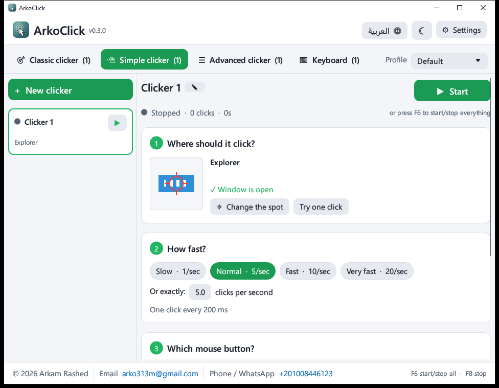
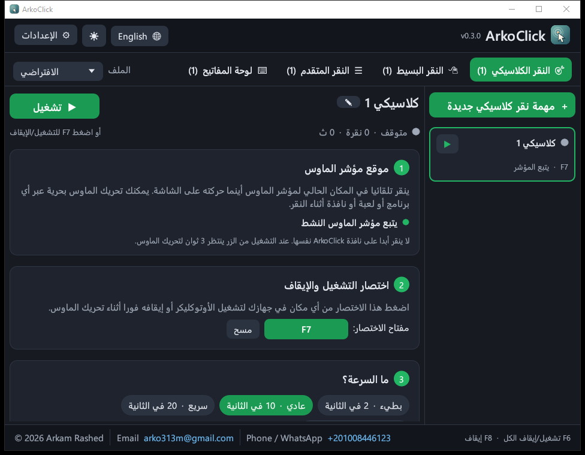

<p align="center"></p>

<h1 align="center">ArkoClick</h1>

<p align="center"><b>Free auto clicker for Windows that keeps clicking inside a window, even when it's minimized or covered, and leaves your mouse free.</b></p>

<p align="center">
  <a href="https://github.com/arkamrashed97/ArkoClick/releases/latest/download/ArkoClick-Setup.exe"></a>
  &nbsp;
  <a href="https://github.com/arkamrashed97/ArkoClick/releases/latest/download/ArkoClick-portable.zip"></a>
</p>

<p align="center">Windows 10 / 11 (64-bit) · Free · English & العربية · <a href="https://github.com/arkamrashed97/ArkoClick/releases">All versions</a> · <a href="#بالعربي">بالعربي</a></p>

<p align="center">
  
  
</p>

## Install

1. Click **Download Installer** above and open `ArkoClick-Setup.exe`.
2. If Windows shows a blue **"Windows protected your PC"** box, click **More info**, then **Run anyway**. (ArkoClick isn't code-signed yet; this is expected.)
3. Follow the installer. No administrator rights are needed.

Prefer not to install? Download the **portable zip**, unzip it anywhere, and run `ArkoClick.exe`.

## Use it in 3 steps

1. Open ArkoClick. In the **Simple clicker** tab press **Choose the spot on screen**, then click the place you want clicked.
2. Choose a speed, for example **Normal · 5/sec**.
3. Press **Start**. Press **Stop** or **F6** to stop, or **F8** to stop everything at once.

You can keep working while it clicks. Minimize the window or put it behind others and ArkoClick keeps going.

Want a classic auto clicker that clicks wherever your mouse is instead? Use the **Classic clicker** tab: set a shortcut such as **F7**, move the mouse anywhere, and press the shortcut to start or stop.
Try it first with **ArkoClick test page** in the Start menu: choose its green circle as the spot and watch the counter.

## بالعربي

<div dir="rtl">

**ArkoClick** برنامج نقر تلقائي مجاني لويندوز. يضغط داخل النافذة التي تختارها حتى لو كانت مصغّرة أو خلف نوافذ أخرى، ويبقى الماوس حرًا لك.

**التحميل:**
[تحميل برنامج التثبيت (موصى به)](https://github.com/arkamrashed97/ArkoClick/releases/latest/download/ArkoClick-Setup.exe)
·
[تحميل النسخة المحمولة](https://github.com/arkamrashed97/ArkoClick/releases/latest/download/ArkoClick-portable.zip)

**التثبيت:**
1. افتح ملف `ArkoClick-Setup.exe`.
2. إذا ظهر تحذير أزرق من ويندوز، اضغط **More info** ثم **Run anyway**.
3. أكمل التثبيت، ولا يحتاج إلى صلاحيات المسؤول.

**الاستخدام:**
1. في تبويب «النقر البسيط» اضغط «اختر المكان على الشاشة» ثم انقر على المكان المطلوب.
2. اختر السرعة.
3. اضغط «تشغيل»، وللإيقاف اضغط «إيقاف» أو F6، وF8 يوقف كل شيء.

**النقر الكلاسيكي:** تبويب «النقر الكلاسيكي» ينقر في مكان مؤشر الماوس أينما حركته. عيّن له اختصارًا مثل F7، ثم اضغطه للتشغيل أو الإيقاف.

</div>

## Contact

**Arkam Rashed** · arko313m@gmail.com · WhatsApp [+201008446123](https://wa.me/201008446123)

---

# Details

## Made for everyone

- **Four tabs.** *Classic clicker*: clicks wherever your mouse is; start and stop it with a
  shortcut (F7 by default for new tasks). *Simple clicker*: choose a spot, choose a speed,
  press Start. *Advanced clicker*: sequences of clicks, keys and text with every option.
  *Keyboard*: press a key or type a text into a window, repeatedly.
- **Step-by-step cards** (1, 2, 3, 4) with big buttons, speed presets in plain words
  ("Normal · 5/sec"), and a zoomed picture of the exact spot that will be clicked.
- **English and Arabic.** The Arabic interface is fully translated and mirrored
  right-to-left, with correctly joined letters (shaping via `ar-reshaper`, ordering via
  `unicode-bidi`). Text is typed into a native Windows box, so Arabic input is perfect.
- **Day, night, or follow Windows**, switchable from the header in one click.

## What it does

- **Clicks inside a chosen window, not at a screen position.** Each clicker is bound to a
  window (by handle at runtime, by class + process name across restarts) and points inside
  its client area. Input is delivered with `PostMessage`, so the real mouse never moves and
  you keep using the PC.
- **Step sequences.** A clicker runs a list of steps in order and repeats: mouse clicks
  (left/right/middle, single/double, each with its own point), key presses, and typed text
  (any language, Arabic and emoji included). Every step has its own wait time.
- **Keeps working when the target is minimized.** While a clicker runs, minimizing its
  window turns into "hidden but running" (invisible, click-through, not minimized), because
  many apps, all Chromium browsers included, ignore input while minimized. Clicking the
  window's taskbar button brings it back; stopping the clicker returns it to minimized. A
  manual **Hide window (keep running)** button does the same on demand.
- **Survives resize / maximize.** Points are stored relative to the client size.
- **Many clickers at once**, on different windows or the same one, all driven by **one
  scheduler thread** (a min-heap of deadlines on a condvar). Idle CPU is zero.
- **Profiles**: named sets of clickers (New / Copy / Rename / Delete) to switch between.
- **Hotkeys**: global start/stop-all and emergency stop, plus an optional hotkey per
  clicker. Shortcuts are recorded by pressing them (Ctrl / Alt / Shift supported).
- **Launch with Windows** (HKCU Run key), start hidden in the tray, tray menu (start/stop
  all, show hidden windows, quit), auto-run selected clickers at launch.
- **Picker overlay** with magnifier and crosshair, or choose a window from a list.
- Segoe UI text with adjustable size; Segoe UI Symbol for icons.
- Config lives in `%APPDATA%\ArkoClick\config.json` (v0.1 configs are migrated).

## Measured in Chrome

`cargo run --release --example chrome_probe` with the test page open, 40 actions each:

| Window state | Clicks | Keys |
|---|---|---|
| Visible | 40 / 40 | 40 / 40 |
| Minimized (raw, helper off) | 0 / 40 | 0 / 40 |
| Hidden with ArkoClick | 40 / 40 | 40 / 40 |
| Minimized in the middle of a run (helper on) | 40 / 40 | |

Text steps typed 95 of 95 characters (Arabic included) both visible and hidden.

## Known limits

- Apps that read **raw input / DirectInput** (most games) ignore posted messages. Use
  Foreground mode for those (it moves the real cursor and needs the window visible), or the
  Classic clicker tab.
- Clicking into a window that runs **as administrator** requires ArkoClick to run as
  administrator too (UIPI).
- **Key steps** produce the character of the target's active keyboard layout (A types "ش"
  on an Arabic layout). Use a **Text step** for exact text. Modifier combos (Ctrl+C) cannot
  be faked through messages.
- Key and text steps go to the field that has focus inside the target. Click the field once,
  or put a Click step on it before the Key/Text step.
- egui draws Arabic unjoined inside ArkoClick's own text boxes; what gets typed is correct.

## Build

Rust stable with the `x86_64-pc-windows-gnu` host (or MSVC with Visual Studio Build Tools).
The GNU toolchain also needs MinGW-w64 binutils (`dlltool`, `as`) because the `windows`
crate links through `raw-dylib`.

```
cargo build --release
cargo test
```

For the GNU toolchain, copy `.cargo/config.toml.example` to `.cargo/config.toml`, point
`linker` and `dlltool` at your MinGW-w64 install, and put its `bin` folder on `PATH` so
`windres` embeds the icon and version info. The example also moves the target directory,
because `dlltool` fails on paths that contain spaces.

### Installer

Needs [Inno Setup 6](https://jrsoftware.org/isinfo.php):

```
ISCC.exe installer\ArkoClick.iss
```

Builds `dist/ArkoClick-Setup.exe` from `dist/ArkoClick.exe` (copy the release build
there first). Per-user install to `%LOCALAPPDATA%\Programs\ArkoClick` (no administrator
rights), English or Arabic wizard, Start-menu entries (app, test page, uninstall), optional
desktop shortcut and "start with Windows", and a short guide shown at the end
(`installer/guide-*.txt`). Uninstall removes everything, including the startup entry. The
exe and installer are not code-signed, so Windows SmartScreen warns on first run.

Release files keep fixed names (`ArkoClick-Setup.exe`, `ArkoClick-portable.zip`) so the
download buttons at the top always point at the newest release. The test page
(`test-target/ArkoClick-TestTarget.html`) counts clicks, key presses and typed characters,
and mirrors the counters into its window title.

Tests create real Win32 windows and verify: clicks reach the right child control at the right
coordinates, delivery while minimized and while hidden, minimize-to-hidden and back on stop,
step order, key and Unicode text delivery, action limits, re-binding after the window is
recreated, and v0.1 config migration.

## Layout

```
src/
  main.rs          entry, single instance, flags (--autostart / --hidden), crash safety
  config.rs        data model (profiles, clickers, steps, hotkeys) + JSON persistence
  engine/mod.rs    scheduler thread, target binding, step dispatch, auto-hide
  win/             Win32 wrappers
    window.rs      lookup, geometry, child-control hit testing, focus
    input.rs       PostMessage clicks / keys / text, SendInput
    ghost.rs       hide a window without minimizing it (+ crash recovery)
    watch.rs       WinEvent hook: minimize -> hidden, activation -> visible
    hotkey.rs      global hotkeys thread
    tray.rs        tray icon and menu
    picker.rs      full-screen target picker (GDI)
    autostart.rs, screen.rs, timer.rs
    textdlg.rs     native text-entry box (Arabic-correct)
  ui/
    mod.rs         window, header, tabs, task list, shared editor parts
    simple.rs      Simple clicker tab
    advanced.rs    Advanced clicker tab
    keyboard.rs    Keyboard tab
    settings.rs    Settings window
    widgets.rs     language-aware rows, cards, chips, switches
    rtl.rs         Arabic shaping + bidi for display
    theme.rs       fonts, light/dark colours
tests/background_click.rs   end-to-end Win32 tests
examples/chrome_probe.rs    Chromium delivery measurement
examples/picker_demo.rs     opens the picker overlay (Arabic hint) for visual checks
examples/make_icons.rs      renders assets/logo.svg into icon.ico and the embedded logo images
test-target/                click/key/text counter page
```

## Credits

Picker and tray approach adapted from
[xiaobainiuniu/auto-clicker](https://github.com/xiaobainiuniu/auto-clicker) (MIT, see
[THIRD_PARTY_NOTICES.md](THIRD_PARTY_NOTICES.md)).
Background-click technique informed by
[PriyanshuGeTRekT/WinClicker](https://github.com/PriyanshuGeTRekT/WinClicker) (C#, MIT) and
[Cling2223/auto-clicker](https://github.com/Cling2223/auto-clicker).

## License

MIT, see [LICENSE](LICENSE).
